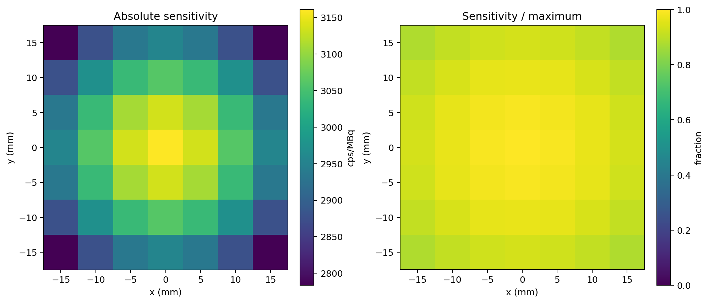
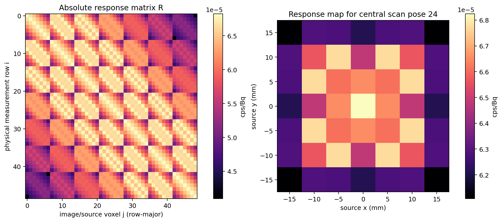
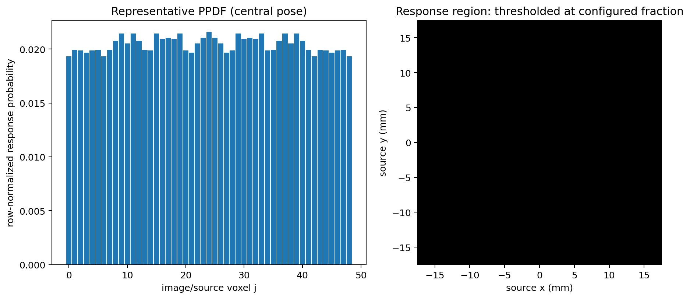
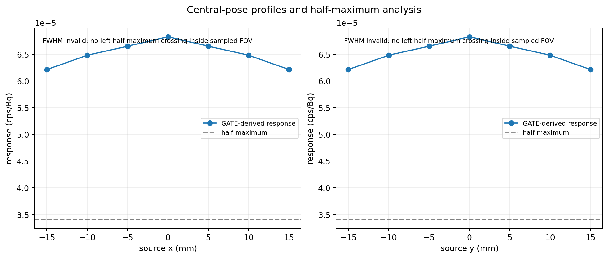
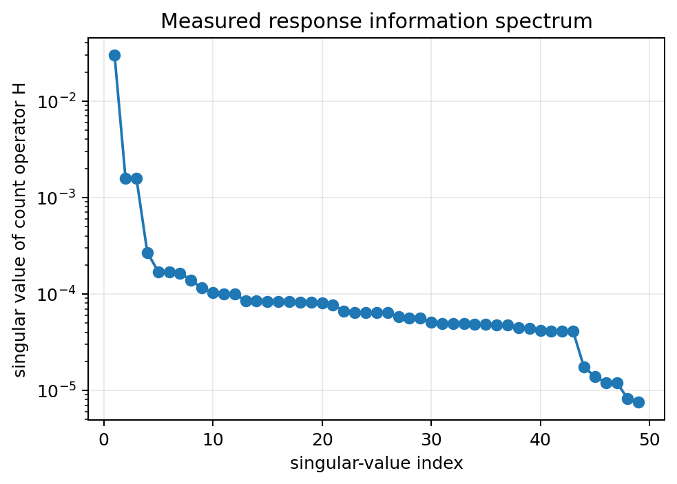
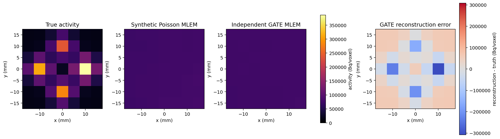
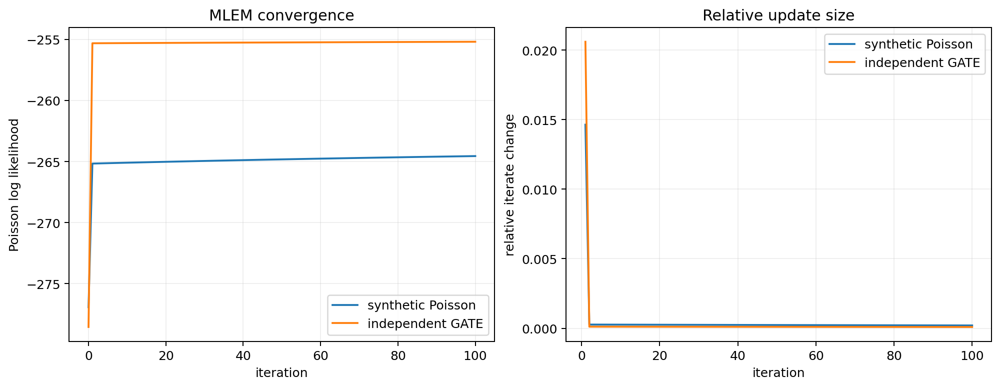
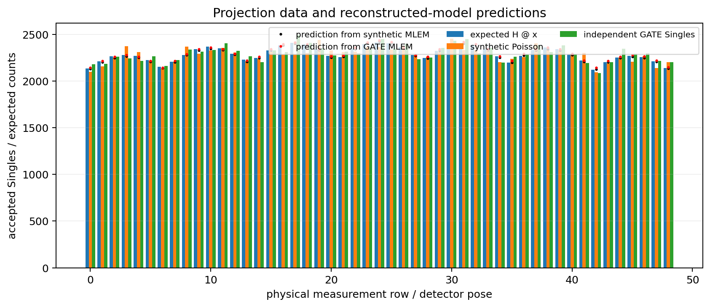
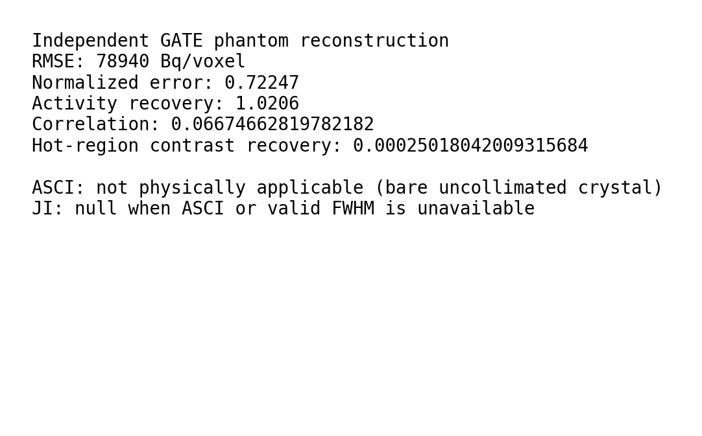

# OneCube Imaging Final — Preparation and Runtime Results

## Preparation status

Static preparation is complete. The full GATE imaging experiment has not run. This report contains no measured response matrix, sensitivity map, FWHM result, reconstruction, or Monte Carlo acceptance claim yet.

## Frozen OneCube baseline

The new project consumes validated assets in the sibling OneCube directory without changing them: one 2×2×2 mm GAGG crystal (detector ID 0), centered at the origin, a 140 keV isotropic source at z = -51 mm, 3.7 MBq, and a 50 mm center-pose surface gap. The baseline recorded 233 Hits and 233 Singles in one second, corresponding to about 62.97 cps/MBq. Existing geometry, digitizer, physics, and ROOT output macros are included at run time; new output paths point only into this project.

## Reference methodology

The Small-Animal-Imaging-SPECT repository was consulted only for mathematical procedures: row/voxel response interpretation, threshold-derived response regions, line-profile FWHM by half-height crossings, angular-bin occupancy for ASCI, JI, forward projection, and multiplicative MLEM with likelihood/convergence plots. Relevant sources: [PPDF interpretation](https://github.com/kirtirajsinhparmar1/Small-Animal-Imaging-SPECT/blob/main/arg_ppdf_t8.py), [response masks](https://github.com/kirtirajsinhparmar1/Small-Animal-Imaging-SPECT/blob/main/arg_extract_beam_masks.py), [beam properties and FWHM](https://github.com/kirtirajsinhparmar1/Small-Animal-Imaging-SPECT/blob/main/beam_property_extract.py), [ASCI filtering](https://github.com/kirtirajsinhparmar1/Small-Animal-Imaging-SPECT/blob/main/arg_analyze_extracted_properties.py), [ASCI mapping](https://github.com/kirtirajsinhparmar1/Small-Animal-Imaging-SPECT/blob/main/asci_plot_generation.py), [JI](https://github.com/kirtirajsinhparmar1/Small-Animal-Imaging-SPECT/blob/main/6_calc_ji.py), [projection](https://github.com/kirtirajsinhparmar1/Small-Animal-Imaging-SPECT/blob/main/projection_t8.py), and [MLEM](https://github.com/kirtirajsinhparmar1/Small-Animal-Imaging-SPECT/blob/main/mlem_torch_gpf_nonmpi.py). The calculations were independently implemented for OneCube row and voxel maps.

## Geometry isolation

No SAI geometry, detector layout, source position, FOV, pixel grid, attenuation model, numerical result, or geometry-generation code was transferred. Only OneCube frozen Gate macros define the physical geometry. The new project translates the existing detector hierarchy as one rigid body and places sources in its own image plane.

## Final acquisition design

The image is a 7×7, 35×35 mm sampled plane at z = -51 mm with 5 mm voxel pitch. The matching physical scan translates the single crystal through 49 XY poses on the same 5 mm grid at z = 0, with fixed orientation. At the center pose the validated 50 mm crystal-surface gap is preserved. Each translated detector pose is one actual independent exposure and one measurement row; rows are not virtual detector bins.

The physical geometry has a single GAGG crystal and homogeneous-Air support volumes. A fixed-axis 2×2 mm square crystal, isotropic point source, and uniform air permit expected-response reuse under lateral sign flips and x/y swaps (D4 symmetry). Calibration directly simulates every unique relative XY offset in the grid difference set: {(|dx|,|dy|): 0 ≤ |dy| ≤ |dx| ≤ 30 mm}, 28 conditions. No response outside this measured offset grid is extrapolated. The symmetry mapping is recorded per matrix element. Reuse is valid only while material, source, detector orientation, energy, digitizer, and physics remain unchanged.

Calibration uses a 3.7 MBq point source for 10 s per unique offset; the independent phantom uses the same total activity and 10 s per physical pose. Task counts are 28 calibration conditions and 49 phantom exposures, for 77 Gate invocations and a planning estimate of 2,849,000,000 emitted histories. The baseline yielded 233 Singles per 3.7 million emitted histories, so a 10 s central calibration would be about 2,330 Singles if its response repeats; this is planning extrapolation, not a new measurement. Baseline logs contain no reliable elapsed-time measurement, so no wall-time claim is made. Slurm workers request one CPU and 8 GB each, four workers maximum (32 GB aggregate), and 24 hours per worker allocation.

Image coordinates map directly to Gate x/y in millimetres; sources lie at z = -51 mm. Detector pose coordinates translate the Gate cylindricalPET parent and all daughters at z = 0, with no rotation. The response is measured at source-minus-detector relative positions.

## System-matrix contract

Matrix rows i are physical detector-pose exposures in runtime/manifests/measurement_row_map.csv; columns j are image voxels/source points in runtime/manifests/image_voxel_map.csv ordered row-major by y then x. The measured calibration count is nᵢⱼ. Its response estimate is Rᵢⱼ = nᵢⱼ/(a·tcal), in cps/Bq. The expected-count operator is Hᵢⱼ = Rᵢⱼ·Tᵢ, in expected counts/Bq for phantom exposure at row i. The 49×49 matrix is assembled by the explicit measured relative-offset map. raw_counts_symmetry_expanded.npy records observed counts reused under exact symmetry; it does not claim independent event counts for every element. Unique task ROOT files and count metadata remain available for audit.

## Sensitivity, response masks, FWHM

Sensitivity maps use the configured absolute system sensitivity Sⱼ = sumᵢRᵢⱼ in cps/Bq and cps/MBq. The time-weighted mean sensitivity for a sequential scan, sumᵢ(TᵢRᵢⱼ)/sumᵢTᵢ, and integrated scan counts/Bq are retained as separately labeled quantities. Per-pose masks threshold measured response at the configured fraction of the row peak. Axis profiles through each response maximum use linearly interpolated half-maximum crossings; widths without both crossings inside the calibrated FOV are invalid and retain reasons. Runtime FWHM is not available before Gate runs.

## ASCI and JI applicability

Reference ASCI counts occupied angular bins of valid beam masks over each image pixel. OneCube's translated bare uncollimated crystal has no beam-direction encoding; pose-position azimuth is not a projection angle. Beam-based ASCI is configured as NOT PHYSICALLY APPLICABLE, and no ASCI heatmap or fabricated angular occupancy is emitted. A separate pose-design plot shows translations only. JI follows (mean_sensitivity_cps_per_bq / mean_fwhm_mm²) × (ASCI_percent/100) and remains null unless all three inputs are physically defined and measured.

## Phantom and independent Gate data

The phantom is a 7×7 voxel-grid object with four independently weighted Gaussian hot spots and a low positive background, normalized once to 3.7 MBq total. Each voxel is represented by an isotropic 140 keV point source whose activity equals that voxel's Bq value. Every detector pose receives a separate Gate phantom acquisition with the complete source distribution. Those Singles counts are the primary measured data vector. Model-based expected and seeded Poisson projections are comparison data and are not independent Gate validation.

## Forward projection and MLEM

Forward projection uses y_expected = H @ x_true; a seeded synthetic comparison is Poisson sampled. MLEM consumes generic H[measurement,voxel] and y[measurement] arrays, uses H.T @ ones sensitivity, positive uniform initialization over observable voxels, nonnegative updates, explicit epsilon stabilization, and saves every configured iterate, relative update, and Poisson log likelihood. Filtering is disabled. Synthetic-Poisson and independent-Gate reconstructions are evaluated separately.

## Runtime results

<!-- RUNTIME_RESULTS_START -->
Production runtime completed. Values below were loaded from task records and generated runtime artifacts; they are not static-preparation estimates.

- Runtime software validation: **SOFTWARE PIPELINE COMPLETE; LINEAR IDENTIFIABILITY SCREEN PASSED**.
- Calibration: 28 completed tasks; 59019 raw Singles and 59067 raw Hits.
- System response: shape `[49, 49]`, numerical rank 49/49, retained-subspace condition number 3975.88.
- Pose-summed absolute sensitivity: central 0.00316068 cps/Bq (3160.68 cps/MBq); mean 0.00298025 cps/Bq (2980.25 cps/MBq); range 0.00278354–0.00316068 cps/Bq. Sequential scan-average mean: 6.08215e-05 cps/Bq.
- FWHM: 0 valid axis profiles; mean not defined mm. Invalid profiles and their crossing reasons are retained in `results/fwhm/fwhm_summary.json`.
- ASCI: **NOT PHYSICALLY APPLICABLE** — A bare uncollimated crystal has no beam-direction encoding. Translation-pose azimuth is not a projection angle and is not used as ASCI..
- JI: not defined; valid=False; reason=no valid half-maximum FWHM profiles.
- Independent GATE phantom acquisitions: 49 pose exposures, 112540 Singles total.
- Independent GATE MLEM: RMSE 78940.4 Bq/voxel; normalized error 0.722468; correlation 0.0667466; total-activity recovery 1.02057; hot-region contrast recovery 0.00025018.
- Linear identifiability screen: True; this is a rank/conditioning screen, not a resolution or image-quality guarantee.
- Synthetic Poisson results are retained separately and are not treated as independent experimental validation.
- Scientific acceptance requires interpretation of the measured response spectrum, independent-GATE reconstruction, residuals, and recovery metrics; software validation alone is not acceptance.

### Runtime figures


















<!-- RUNTIME_RESULTS_END -->

## Scientific limits

The bare single crystal is uncollimated and its axial source response is broad. Translation produces independent physical measurements but may yield a strongly correlated, poorly conditioned response matrix; measured singular values and reconstruction errors determine what can be claimed. FWHM can be undefined if the sampled FOV does not cross half maximum. ASCI and JI are not expected to be defined for this response. The inherited OneCube physics macro is preserved; this experiment does not silently upgrade or claim validation of omitted interaction processes.

## MagicCubeFinal transfer

Generic matrix input, absolute response normalization, sensitivity, PPDF, threshold masks, interpolated FWHM, physically gated ASCI/JI, phantom vectors, projection, MLEM, metrics, diagnostics, and plotting consume arrays and explicit row/voxel maps. MagicCubeFinal can reuse these modules with its own detector map, acquisition map, voxel grid, event reducer, and response matrix. The OneCube GATE macro generator and D4 symmetry reducer are system-specific and require a separate physical proof before reuse.

## Preparation validation and launch

Static preparation checks deterministic ordering, 28 relative-offset tasks, 49 independent measurement rows, 49 voxel columns, macro isolation/output paths, phantom activity normalization, and shard configuration. Runtime validation additionally requires all GATE tasks, ROOT Singles counts, matrix products, reconstructions, plots, and provenance. Scientific acceptance is deferred to measured outputs.

Manual production command:

```bash
cd "/vscratch/grp-rutaoyao/Kirtiraj/Magic Cube/mcsim/OneCubeImagingFinal/slurm"
bash par_imaging_full.sh
```
